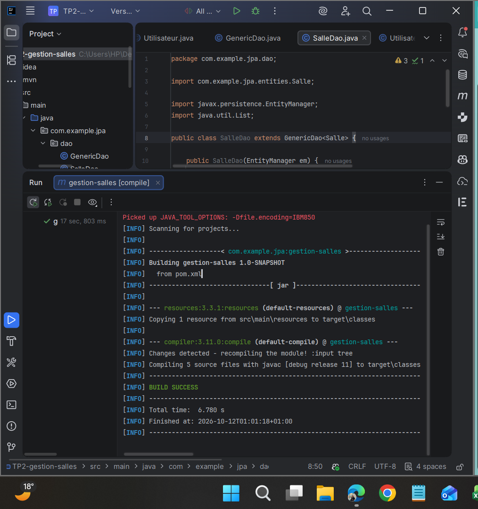
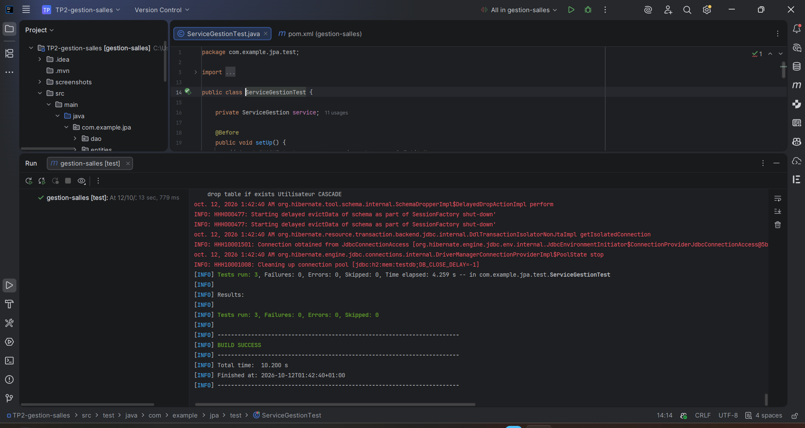

# TP2 – Gestion des salles avec JPA / Hibernate (sans EJB)

Application Java SE qui gère des **salles** et des **utilisateurs** avec JPA, Hibernate et une base **H2 en mémoire**. Les transactions sont gérées à la main avec `EntityTransaction`, et le fonctionnement est validé par des tests **JUnit 4**.

## Technologies

| Outil | Version |
|---|---|
| Java (compilation) | 11 |
| Hibernate ORM | 5.6.15.Final |
| JPA (`javax.persistence`) | 2.2 |
| H2 Database | 2.1.214 |
| JUnit | 4.13.2 |
| Maven | 3 |

## Architecture

```
src/
├── main/
│   ├── java/com/example/jpa/
│   │   ├── entities/   Salle, Utilisateur
│   │   ├── dao/        GenericDao, SalleDao, UtilisateurDao
│   │   └── service/    ServiceGestion
│   └── resources/META-INF/
│       └── persistence.xml
└── test/
    └── java/com/example/jpa/test/
        └── ServiceGestionTest
```

## Modèle de données

- **Salle** : `id`, `nom` (obligatoire, unique), `capacite` (obligatoire)
- **Utilisateur** : `id`, `nom` (obligatoire), `email` (obligatoire, unique), `salle`
- Relation **`@ManyToOne`** : plusieurs utilisateurs peuvent être rattachés à une même salle, via la clé étrangère `salle_id` dans la table `Utilisateur`.

## Couches

- **DAO générique** (`GenericDao<T>`) : CRUD commun (`create`, `find`, `update`, `delete`, `findAll`), avec `begin()` / `commit()` / `rollback()`.
- **DAO spécifiques** :
    - `SalleDao.findByCapaciteMin(int)` : salles d'au moins N places ;
    - `UtilisateurDao.findBySalleNom(String)` : utilisateurs d'une salle (jointure implicite `u.salle.nom`).
- **Service** (`ServiceGestion`) : crée l'`EntityManagerFactory` et l'`EntityManager`, et expose les méthodes métier aux tests.

## Configuration

`persistence.xml` : unité `gestionPU`, transactions `RESOURCE_LOCAL`, base `jdbc:h2:mem:testdb`, affichage du SQL activé.

Choix effectué : `hibernate.hbm2ddl.auto = create-drop` (au lieu de `update`). Avec `DB_CLOSE_DELAY=-1`, la base H2 reste en vie pendant toute l'exécution. `create-drop` supprime les tables à chaque fermeture de l'`EntityManagerFactory`, donc chaque test démarre sur une base vide et les tests ne dépendent pas de leur ordre d'exécution.

## Tests

| Test | Ce qui est vérifié |
|---|---|
| `testCreationEtRechercheSalle` | Création d'une salle et lecture avec `findAll()` |
| `testCreationUtilisateurAvecSalle` | Création d'un utilisateur relié à sa salle (`@ManyToOne`) |
| `testRechercheUtilisateursParSalle` | Requête JPQL avec jointure sur le nom de la salle |

Compilation du projet (`mvn compile`) :



Lancer les tests :

```bash
mvn clean test
```

Résultat des tests, avec le SQL généré par Hibernate :



## SQL généré par Hibernate

Pendant les tests, la console affiche les requêtes générées :
- `create table Salle` / `create table Utilisateur`, avec les contraintes `unique` et la clé étrangère `salle_id` ;
- les `insert into Salle` / `insert into Utilisateur` ;
- pour `findBySalleNom`, la jointure `Utilisateur cross join Salle where salle_id = id and nom = ?`, traduction SQL de `u.salle.nom` ;
- les `drop table` à la fermeture (effet de `create-drop`).